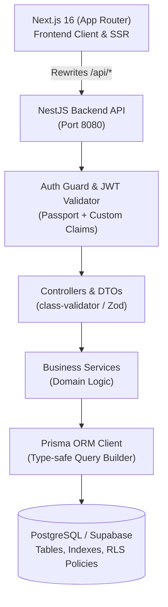

# 🐾 Healthy Pets: Documento de Investigación Arquitectónica y Plan de Implementación

**Autor:** Arquitecto de Software Senior y Experto en Bases de Datos  
**Fecha:** Octubre 2026  
**Proyecto:** Healthy Pets - Sistema de Gestión Veterinaria  
**Frontend Base:** Next.js 16 (App Router) en [`HD_frontend`](https://github.com/Brunux-hub/HD_frontend.git)  

---

## 1. Resumen Ejecutivo y Objetivos

El proyecto **"Healthy Pets"** tiene como meta modernizar y digitalizar la operación integral de una clínica veterinaria. La plataforma abarca desde el flujo clínico (citas, consultas médicas, cartilla de vacunación y seguimiento de pacientes) hasta la gestión administrativa y operativa (catálogo de servicios, control de personal: veterinarios y recepcionistas, usuarios y analítica de atenciones).

El frontend ya se encuentra construido en Next.js con TailwindCSS y Shadcn UI. El presente documento sienta las bases para el diseño del backend, el modelado de datos en **PostgreSQL**, y la estrategia de autenticación y autorización con roles estrictos y políticas **Row Level Security (RLS)**.

---

## 2. Análisis del Frontend Existente (`HD_frontend`)

Tras una inspección minuciosa del código fuente del repositorio, se identificaron los contratos de datos, las dependencias y las particularidades que el backend debe respetar al 100% para garantizar compatibilidad sin fricciones:

### 2.1. Arquitectura de Comunicación Frontend-Backend
* **Mecanismo de Proxy/Rewrite:** `next.config.ts` redirige todas las llamadas `/api/:path*` hacia `BACKEND_URL` (por defecto `http://localhost:8080`).
* **Interceptor Axios (`lib/axios.ts`):** Inyecta automáticamente el encabezado `Authorization: Bearer <token>` extraído de la cookie `hd_vet_token` en todas las rutas privadas.
* **Manejo de Errores:** El frontend espera respuestas de error en formato JSON con `{ message?: string, error?: string }` y códigos HTTP semánticos (401 para no autenticado/sesión expirada, 403 para prohibido, 404, 400).
* **Nombres de Enrutamiento (Singular vs Plural):**
  * `/appointment` (singular)
  * `/owner` (singular)
  * `/pet` (singular)
  * `/medical_history` (singular con snake_case)
  * `/receptionist` (singular)
  * `/veterinarian` (singular)
  * `/services` (plural)
  * `/user` (singular)
  * `/vaccine` (singular)
  * `/vaccination` (singular)
  * `/reports` (plural: `/reports/completed-services`, `/reports/appointments?status=...`)
  * `/auth` (`/auth/login`, `/auth/me`, `/auth/register`)

### 2.2. Convenciones de Nomenclatura y Casos Especiales de DTOs
1. **Naming Snake_Case:** Los tipos e interfaces reflejan la serialización Jackson/Spring Boot (`id_user`, `id_owner`, `id_pet`, `id_medical_history`, `id_vaccination`, `pet_gender`, `number_license`).
2. **Entidad Mascota (Pet):**
   * Al **crear o editar** (`POST/PUT /pet`), el frontend envía la propiedad `sex` (`MALE` | `FEMALE`).
   * Al **recibir** (`GET /pet`), el frontend espera que el objeto incluya `pet_gender` (`MALE` | `FEMALE`) y el objeto anidado completo `owner: Owner`.
3. **Entidad Veterinario (Veterinarian):**
   * En la respuesta `GET /veterinarian`, el usuario asociado viene nombrado como `user_response: User`.
4. **Entidad Historial Médico (MedicalHistory):**
   * El servicio asociado viene como propiedad `services: Service` (objeto individual) y la cita como `appointment: Appointment` (con sus relaciones completas `pet`, `veterinarian`, `receptionist`).
5. **Autenticación y Roles:**
   * `POST /auth/login` recibe `{ username, password }` y responde `{ token: string }`.
   * `GET /auth/me` responde `{ username: string, role: "ADMIN" | "VETERINARIAN" | "RECEPTIONIST" | "CLIENT" | "WORKER" }`.
   * `POST /auth/register` (público) registra un cliente: crea la cuenta en `users` y la ficha en `owners`, respondiendo con la entidad `Owner`.
   * `GET /owner/me` devuelve los datos de la ficha del cliente autenticado o `204 No Content` si es un miembro del staff.
   * `GET /owner/dni/{dni}` consulta un cliente por su documento de identidad.

---

## 3. Decisiones de Stack Tecnológico y Justificación

### 3.1. Backend: Node.js con NestJS
* **Decisión:** **NestJS** (en carpeta dedicada dentro del repositorio o monorepo `backend/`).
* **Justificación frente a Next.js API Routes:**
  1. **Arquitectura Empresarial Limpia:** NestJS implementa una arquitectura modular (módulos, controladores, servicios, DTOs, pipes e interceptores) inspirada en principios SOLID y Domain-Driven Design (DDD). Esto replica fielmente la robustez del diseño original de Spring Boot pero en el ecosistema TypeScript.
  2. **Persistencia y Conexiones:** Next.js Route Handlers en producción (Vercel/serverless) pueden agotar el pool de conexiones de PostgreSQL por creación efímera de instancias lambda. NestJS opera como un proceso persistente con conexión de base de datos eficiente y pool compartido.
  3. **Separación de Responsabilidades:** Mantiene el frontend enfocado en UI/UX y la API en lógica de negocio, validaciones transaccionales y auditoría.
  4. **Documentación Swagger / OpenAPI:** NestJS genera automáticamente la especificación OpenAPI interactiva en `/api/docs`, permitiendo probar todos los endpoints sin herramientas externas.

### 3.2. ORM: Prisma ORM
* **Decisión:** **Prisma ORM**.
* **Justificación frente a Drizzle:**
  1. **Mapeo de Relaciones Profundas:** El frontend requiere respuestas con relaciones anidadas complejas (ej. `Vaccination` -> `MedicalHistory` -> `Appointment` -> `Pet` -> `Owner`). Prisma resuelve esto de manera declarativa y con tipado estricto mediante directivas `include`.
  2. **Modelado y Migraciones Confiables:** El archivo `schema.prisma` proporciona un esquema canónico claro, con migraciones automáticas (`prisma migrate dev`) y un cliente generado que sincroniza tipos con TypeScript en tiempo de compilación.
  3. **Ecosistema NestJS:** Prisma cuenta con integración de primer nivel con NestJS a través de `PrismaService`, ciclo de vida `onModuleInit` y control de desconexión limpia.

### 3.3. Base de Datos: PostgreSQL (Supabase / Neon / Docker Local)
* **Decisión:** **PostgreSQL 16+** con soporte completo para Supabase y Docker local.
* **Justificación:**
  1. Integridad referencial fuerte (Foreign Keys con reglas `ON DELETE RESTRICT` y `ON DELETE CASCADE` estratégicas).
  2. Tipos de datos especializados (`TIMESTAMPTZ`, `DECIMAL(10,2)`, `UUID` o `BIGSERIAL`).
  3. Soporte para **Row Level Security (RLS)** nativo para garantizar seguridad a nivel de motor de datos.

### 3.4. Estrategia de Autenticación y Autorización
* **Decisión:** **JWT (JSON Web Tokens) con Roles Integrados (RBAC) y Compatibilidad Supabase Auth**.
* **Justificación:**
  * El frontend ya implementa el consumo de JWT a través de cabeceras `Authorization: Bearer <token>`.
  * Diseñaremos el emisor de tokens en NestJS usando `@nestjs/jwt` y `bcrypt`, configurando el payload con `{ sub: user.id_user, username: user.username, role: roleName }`.
  * Este payload se sincroniza con las convenciones de Supabase Custom Claims (`app_metadata.user_roles`), permitiendo que las políticas RLS de PostgreSQL evalúen la identidad del usuario tanto si las consultas provienen de la API de NestJS como si se ejecutan directamente en Supabase.

---

## 4. Investigación de Modelado de Datos en el Dominio Veterinario

### 4.1. Mejores Prácticas de la Industria (Veterinary EHR / PIMS)
1. **Separación Estricta entre Propietario (Owner) y Paciente (Pet):**
   * Un dueño puede tener múltiples mascotas a lo largo del tiempo. Las mascotas nunca deben ser campos embebidos en el cliente.
   * La ficha del paciente debe registrar: nombre, especie, raza, fecha de nacimiento, sexo (`MALE`/`FEMALE`), peso y marcas de identificación.
2. **Ciclo de Vida de la Cita Médica (Appointment Lifecycle):**
   * Estados normalizados: `OPENED` (programada/abierta), `CLOSED` (atendida y finalizada), `CANCELED` (cancelada), `RESCHEDULED` (reprogramada).
   * La cita vincula a tres actores esenciales: el paciente (`Pet`), el veterinario responsable (`Veterinarian`) y el recepcionista que agenda (`Receptionist`).
3. **Historial Clínico y Registro Médico (Medical History):**
   * Cada atención médica completada genera un registro en `medical_histories` vinculado a la cita (`appointment`) y al servicio prestado (`service`).
   * La descripción almacena la evaluación clínica (anamnesis, diagnóstico, tratamiento).
4. **Cartilla de Vacunación (Vaccination & Vaccine Protocol):**
   * El catálogo de vacunas (`vaccines`) especifica fabricante, descripción y dosis requeridas.
   * La aplicación de vacuna (`vaccinations`) se vincula directamente al historial médico de la atención, guardando la fecha de aplicación, la fecha estimada de la próxima dosis (refuerzo) y observaciones.

---

## 5. Estrategias de Indexación y Seguridad (Row Level Security - RLS)

### 5.1. Estrategia de Indexación en PostgreSQL
Para responder en tiempos sub-milisegundo a las consultas del frontend, se diseñan los siguientes índices B-Tree:

| Tabla | Columnas Indexadas | Propósito de Rendimiento |
| :--- | :--- | :--- |
| `owners` | `(dni)` (UNIQUE) | Búsqueda rápida en `/owner/dni/{dni}` y registro de clientes. |
| `owners` | `(id_user)` | Resolución instantánea del cliente actual en `/owner/me`. |
| `pets` | `(id_owner)` | Listado de mascotas asociadas a un dueño en el portal y dashboard. |
| `appointments` | `(date, id_veterinarian)` | Consulta de agenda y prevención de solapamientos horarios. |
| `appointments` | `(status)` | Filtrado de reportes de citas `/reports/appointments?status=...`. |
| `appointments` | `(id_pet)` | Histórico de citas de una mascota. |
| `medical_histories` | `(id_appointment)` | Enlace 1:1 con la cita clínica. |
| `vaccinations` | `(id_medical_history, id_vaccine)` | Búsqueda de vacunas aplicadas en una atención. |
| `vaccinations` | `(next_application_date)` | Alertas y cálculo de vacunas vencidas o próximas en el portal del cliente. |

### 5.2. Row Level Security (RLS) y Control de Acceso por Roles (RBAC)

Se definen 5 roles en el sistema:
1. `ADMIN`: Control total de la plataforma (usuarios, configuraciones, reportes financieros y eliminación).
2. `VETERINARIAN`: Acceso a pacientes, citas, creación y modificación de historiales médicos y cartillas de vacunación. Restringido para ver salarios o nómina de recepcionistas.
3. `RECEPTIONIST`: Gestión de clientes (`owners`), alta de mascotas (`pets`) y programación de citas (`appointments`). Solo lectura en historiales médicos.
4. `CLIENT`: Acceso exclusivo de solo lectura a su propia ficha de cliente (`owners`), sus mascotas (`pets`), sus citas programadas y el carnet de vacunas de sus animales.
5. `WORKER`: Rol genérico para personal auxiliar de clínica con permisos operativos limitados.

#### Modelo de Políticas RLS:
* **Habilitación de RLS:** Todas las tablas de datos (`owners`, `pets`, `appointments`, `medical_histories`, `vaccinations`, `services`, `vaccines`) tendrán `ALTER TABLE ... ENABLE ROW LEVEL SECURITY;`.
* **Políticas para Staff (`ADMIN`, `VETERINARIAN`, `RECEPTIONIST`):**
  * Políticas permisivas basadas en el claim de rol (`auth.jwt() ->> 'role' IN ('ADMIN', 'VETERINARIAN', 'RECEPTIONIST')`).
* **Políticas para Clientes (`CLIENT`):**
  * Lectura en `owners`: `WHERE id_user = auth.uid()`.
  * Lectura en `pets`: `WHERE id_owner IN (SELECT id_owner FROM owners WHERE id_user = auth.uid())`.
  * Lectura en `appointments`: `WHERE id_pet IN (SELECT id_pet FROM pets WHERE id_owner IN (SELECT id_owner FROM owners WHERE id_user = auth.uid()))`.

---

## 6. Plan de Implementación de Alto Nivel

### 📌 Fase 1: Investigación y Plan de Arquitectura *(Completada con este artefacto)*
- [x] Análisis del frontend `HD_frontend`, contratos de API y tipos TypeScript.
- [x] Investigación de mejores prácticas para sistemas de gestión veterinaria (PIMS/EHR).
- [x] Definición del stack tecnológico (NestJS + Prisma + PostgreSQL/Supabase).
- [x] Estrategia de seguridad (RLS + RBAC) e indexación.
- [x] Generación del artefacto de arquitectura y solicitud de aprobación.

### 📌 Fase 2: Diseño del Esquema de la Base de Datos (`/schema`)
- [ ] Creación del directorio `/schema` con scripts SQL organizados modularmente:
  - `01_init_types_and_extensions.sql` (Enums: `UserType`, `PetGender`, `AppointmentStatus`, extensiones).
  - `02_create_tables.sql` (DDL completo con PKs, FKs, CHECKs y defaults).
  - `03_create_indexes.sql` (Índices B-Tree optimizados para consultas del frontend).
  - `04_rls_policies.sql` (Políticas de Row Level Security para Supabase/PostgreSQL).
  - `05_triggers_and_functions.sql` (Triggers para `updated_at` automático y validaciones).
- [ ] Creación del Diagrama Entidad-Relación (ER) completo en formato Mermaid (`schema/ER_DIAGRAM.md`).

### 📌 Fase 3: Implementación del Backend (NestJS + Prisma)
- [ ] Inicialización del proyecto backend en la carpeta `backend/` con TypeScript y NestJS.
- [ ] Configuración de Prisma ORM (`prisma/schema.prisma`) reflejando el DDL de PostgreSQL.
- [ ] Configuración del puerto `8080` y prefijo de rutas globales para calzar con el frontend.
- [ ] Implementación del módulo de Autenticación (`AuthModule`):
  - Endpoints: `POST /auth/login`, `GET /auth/me`, `POST /auth/register` (creación transaccional de User + Owner).
  - Estrategia JWT Passport, Guards de roles (`@Roles(...)`, `RolesGuard`) y decoradores personalizados (`@CurrentUser()`).
- [ ] Implementación de módulos de dominio (CRUD completo, DTOs con validación estricta, servicios y controladores):
  - `UsersModule` (`/user`)
  - `OwnersModule` (`/owner`, `/owner/me`, `/owner/dni/:dni`)
  - `PetsModule` (`/pet`) con mapeo bidireccional (`sex` <-> `pet_gender`)
  - `VeterinariansModule` (`/veterinarian`) con objeto `user_response`
  - `ReceptionistsModule` (`/receptionist`)
  - `ServicesModule` (`/services`)
  - `AppointmentsModule` (`/appointment`) con carga de entidades anidadas
  - `MedicalHistoriesModule` (`/medical_history`) con anidamiento de `appointment` y `services`
  - `VaccinesModule` (`/vaccine`)
  - `VaccinationsModule` (`/vaccination`)
  - `ReportsModule` (`/reports/completed-services`, `/reports/appointments`)
- [ ] Documentación OpenAPI / Swagger disponible en `/api/docs`.
- [ ] Redacción del archivo `README.md` del backend con guía paso a paso y variables de entorno (`.env.example`).

### 📌 Fase 4: Verificación, Pruebas y Carga de Datos Sintéticos (Seed)
- [ ] Despliegue de PostgreSQL (mediante Docker Compose local o instancia Supabase).
- [ ] Ejecución de migraciones de base de datos (`prisma migrate` / scripts DDL).
- [ ] Creación y ejecución de un script de Seeding robusto (`prisma/seed.ts`) con:
  - Usuarios administradores, veterinarios, recepcionistas y clientes de prueba con contraseñas seguras.
  - Catálogo de servicios y vacunas reales.
  - Dueños y mascotas con historiales médicos y vacunas vinculadas.
  - Citas en diferentes estados (`OPENED`, `CLOSED`, `CANCELED`, `RESCHEDULED`).
- [ ] Pruebas automatizadas de endpoints con `curl` o script HTTP validando códigos 200/201/204/401/403.
- [ ] Verificación de integración fluida con el frontend `HD_frontend`.

---

## 7. Próximo Paso

Conforme a las instrucciones de la **Fase 1**, el presente artefacto documenta exhaustivamente la investigación técnica, las decisiones arquitectónicas y el plan de trabajo. 

Quedo a la espera de su aprobación para dar inicio a la **FASE 2: DISEÑO DEL ESQUEMA DE LA BASE DE DATOS (`/schema`)**.
