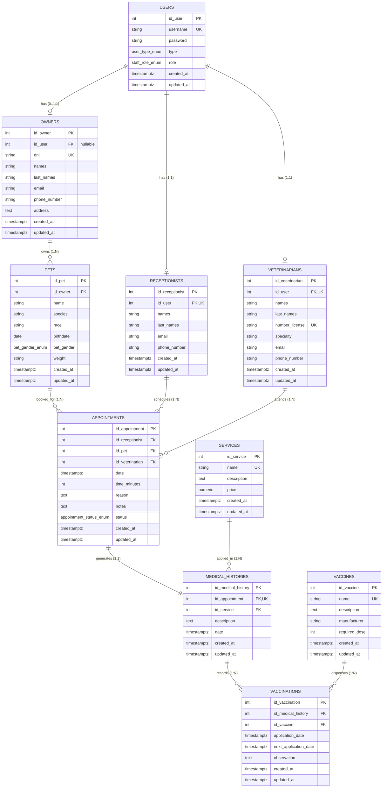

# 📊 Diagrama Entidad-Relación (ER) y Diccionario de Datos

**Proyecto:** Healthy Pets - Sistema de Gestión Veterinaria  
**Motor:** PostgreSQL 16+ (Supabase / Neon / Docker Local)  
**Esquema:** Relacional normalizado (3NF) con optimizaciones para lecturas jerárquicas  

---

## 1. Diagrama Entidad-Relación (Mermaid)

---

## 2. Diccionario de Datos

### 2.1. Tabla `users`
Almacena las credenciales y el tipo/rol general para el inicio de sesión.

| Campo | Tipo | Nulo | Clave / Restricción | Descripción |
| :--- | :--- | :--- | :--- | :--- |
| `id_user` | `SERIAL` | NO | `PRIMARY KEY` | Identificador único del usuario. |
| `username` | `VARCHAR(50)` | NO | `UNIQUE` | Nombre de usuario para login. |
| `password` | `VARCHAR(255)` | NO | - | Contraseña cifrada con algoritmo bcrypt. |
| `type` | `user_type_enum` | NO | `DEFAULT 'WORKER'` | Nivel macro: `'ADMIN'`, `'WORKER'`. |
| `role` | `staff_role_enum` | NO | `DEFAULT 'CLIENT'` | Rol fino: `'ADMIN'`, `'VETERINARIAN'`, `'RECEPTIONIST'`, `'CLIENT'`, `'WORKER'`. |
| `created_at` | `TIMESTAMPTZ` | NO | `DEFAULT NOW()` | Fecha y hora de creación. |
| `updated_at` | `TIMESTAMPTZ` | NO | `DEFAULT NOW()` | Fecha y hora de última modificación. |

---

### 2.2. Tabla `owners`
Ficha de clientes (dueños de mascotas). Puede tener una cuenta de usuario asociada o registrarse presencialmente como walk-in.

| Campo | Tipo | Nulo | Clave / Restricción | Descripción |
| :--- | :--- | :--- | :--- | :--- |
| `id_owner` | `SERIAL` | NO | `PRIMARY KEY` | Identificador único del dueño. |
| `id_user` | `INT` | SÍ | `UNIQUE`, `FK (users.id_user)` | Cuenta de login asociada (si se registró). |
| `dni` | `VARCHAR(20)` | NO | `UNIQUE`, `CHECK (length >= 5)` | Documento Nacional de Identidad. |
| `names` | `VARCHAR(100)` | NO | - | Nombres del propietario. |
| `last_names` | `VARCHAR(100)` | NO | - | Apellidos del propietario. |
| `email` | `VARCHAR(150)` | NO | - | Correo electrónico de contacto. |
| `phone_number` | `VARCHAR(30)` | NO | - | Teléfono / móvil de contacto. |
| `address` | `TEXT` | NO | - | Dirección domiciliaria. |
| `created_at` | `TIMESTAMPTZ` | NO | `DEFAULT NOW()` | Fecha de registro en el sistema. |
| `updated_at` | `TIMESTAMPTZ` | NO | `DEFAULT NOW()` | Última actualización. |

---

### 2.3. Tabla `receptionists`
Perfil de recepcionista vinculado obligatoriamente a una cuenta de usuario.

| Campo | Tipo | Nulo | Clave / Restricción | Descripción |
| :--- | :--- | :--- | :--- | :--- |
| `id_receptionist` | `SERIAL` | NO | `PRIMARY KEY` | Identificador del recepcionista. |
| `id_user` | `INT` | NO | `UNIQUE`, `FK (users.id_user)` | Cuenta de usuario asociada. |
| `names` | `VARCHAR(100)` | NO | - | Nombres del recepcionista. |
| `last_names` | `VARCHAR(100)` | NO | - | Apellidos del recepcionista. |
| `email` | `VARCHAR(150)` | NO | - | Correo institucional. |
| `phone_number` | `VARCHAR(30)` | NO | - | Teléfono de contacto. |
| `created_at` | `TIMESTAMPTZ` | NO | `DEFAULT NOW()` | Fecha de alta. |
| `updated_at` | `TIMESTAMPTZ` | NO | `DEFAULT NOW()` | Última modificación. |

---

### 2.4. Tabla `veterinarians`
Médicos veterinarios y especialistas clínicos.

| Campo | Tipo | Nulo | Clave / Restricción | Descripción |
| :--- | :--- | :--- | :--- | :--- |
| `id_veterinarian` | `SERIAL` | NO | `PRIMARY KEY` | Identificador del veterinario. |
| `id_user` | `INT` | NO | `UNIQUE`, `FK (users.id_user)` | Cuenta de usuario de acceso. |
| `names` | `VARCHAR(100)` | NO | - | Nombres del profesional. |
| `last_names` | `VARCHAR(100)` | NO | - | Apellidos del profesional. |
| `number_license` | `VARCHAR(50)` | NO | `UNIQUE` | Número de colegiatura médica (ej. CMVP). |
| `specialty` | `VARCHAR(100)` | NO | `DEFAULT 'General Medicine'` | Especialidad médica o quirúrgica. |
| `email` | `VARCHAR(150)` | NO | - | Correo institucional. |
| `phone_number` | `VARCHAR(30)` | NO | - | Teléfono de contacto. |
| `created_at` | `TIMESTAMPTZ` | NO | `DEFAULT NOW()` | Fecha de registro. |
| `updated_at` | `TIMESTAMPTZ` | NO | `DEFAULT NOW()` | Última actualización. |

---

### 2.5. Tabla `pets`
Mascotas (pacientes de la veterinaria).

| Campo | Tipo | Nulo | Clave / Restricción | Descripción |
| :--- | :--- | :--- | :--- | :--- |
| `id_pet` | `SERIAL` | NO | `PRIMARY KEY` | Identificador de la mascota. |
| `id_owner` | `INT` | NO | `FK (owners.id_owner)` | Propietario legal del animal. |
| `name` | `VARCHAR(100)` | NO | - | Nombre de la mascota. |
| `species` | `VARCHAR(50)` | NO | - | Especie (Canino, Felino, etc.). |
| `race` | `VARCHAR(100)` | NO | - | Raza del paciente. |
| `birthdate` | `DATE` | NO | `CHECK (birthdate <= CURRENT_DATE)` | Fecha de nacimiento. |
| `pet_gender` | `pet_gender_enum` | NO | - | Sexo: `'MALE'`, `'FEMALE'`. |
| `weight` | `VARCHAR(20)` | NO | - | Peso con unidad (ej. `'12.5 kg'`). |
| `created_at` | `TIMESTAMPTZ` | NO | `DEFAULT NOW()` | Fecha de registro. |
| `updated_at` | `TIMESTAMPTZ` | NO | `DEFAULT NOW()` | Última actualización. |

---

### 2.6. Tabla `services`
Catálogo de atenciones y servicios veterinarios ofrecidos por la clínica.

| Campo | Tipo | Nulo | Clave / Restricción | Descripción |
| :--- | :--- | :--- | :--- | :--- |
| `id_service` | `SERIAL` | NO | `PRIMARY KEY` | Identificador del servicio. |
| `name` | `VARCHAR(100)` | NO | `UNIQUE` | Nombre del servicio o procedimiento. |
| `description` | `TEXT` | NO | `DEFAULT ''` | Detalle o alcance del servicio. |
| `price` | `NUMERIC(10,2)` | NO | `CHECK (price >= 0.00)` | Precio unitario del servicio. |
| `created_at` | `TIMESTAMPTZ` | NO | `DEFAULT NOW()` | Fecha de creación en el catálogo. |
| `updated_at` | `TIMESTAMPTZ` | NO | `DEFAULT NOW()` | Última modificación de tarifa. |

---

### 2.7. Tabla `appointments`
Citas médicas programadas.

| Campo | Tipo | Nulo | Clave / Restricción | Descripción |
| :--- | :--- | :--- | :--- | :--- |
| `id_appointment` | `SERIAL` | NO | `PRIMARY KEY` | Identificador de la cita. |
| `id_receptionist`| `INT` | NO | `FK (receptionists.id_receptionist)` | Recepcionista que coordinó la cita. |
| `id_pet` | `INT` | NO | `FK (pets.id_pet)` | Mascota citada. |
| `id_veterinarian`| `INT` | NO | `FK (veterinarians.id_veterinarian)` | Veterinario asignado para la atención. |
| `date` | `TIMESTAMPTZ` | NO | - | Fecha y hora pactada para la cita. |
| `time_minutes` | `INT` | NO | `DEFAULT 30`, `CHECK (> 0)` | Duración estimada en minutos. |
| `reason` | `TEXT` | NO | - | Motivo de la consulta reportado por el cliente. |
| `notes` | `TEXT` | NO | `DEFAULT ''` | Observaciones preliminares de recepción. |
| `status` | `appointment_status_enum`| NO | `DEFAULT 'OPENED'` | `'OPENED'`, `'CLOSED'`, `'CANCELED'`, `'RESCHEDULED'`. |
| `created_at` | `TIMESTAMPTZ` | NO | `DEFAULT NOW()` | Fecha de reserva. |
| `updated_at` | `TIMESTAMPTZ` | NO | `DEFAULT NOW()` | Última actualización de estado. |

---

### 2.8. Tabla `medical_histories`
Historial clínico emitido al completar la atención médica.

| Campo | Tipo | Nulo | Clave / Restricción | Descripción |
| :--- | :--- | :--- | :--- | :--- |
| `id_medical_history` | `SERIAL` | NO | `PRIMARY KEY` | Identificador del historial clínico. |
| `id_appointment` | `INT` | NO | `UNIQUE`, `FK (appointments.id_appointment)` | Cita a la que corresponde la atención. |
| `id_service` | `INT` | NO | `FK (services.id_service)` | Servicio principal ejecutado. |
| `description` | `TEXT` | NO | - | Evaluación médica, hallazgos y prescripción. |
| `date` | `TIMESTAMPTZ` | NO | - | Fecha de realización de la consulta. |
| `created_at` | `TIMESTAMPTZ` | NO | `DEFAULT NOW()` | Registro del reporte clínico. |
| `updated_at` | `TIMESTAMPTZ` | NO | `DEFAULT NOW()` | Modificación del registro. |

---

### 2.9. Tabla `vaccines`
Catálogo de biológicos e inmunizaciones veterinarias.

| Campo | Tipo | Nulo | Clave / Restricción | Descripción |
| :--- | :--- | :--- | :--- | :--- |
| `id_vaccine` | `SERIAL` | NO | `PRIMARY KEY` | Identificador de la vacuna. |
| `name` | `VARCHAR(100)` | NO | `UNIQUE` | Nombre comercial o genérico de la vacuna. |
| `description` | `TEXT` | NO | `DEFAULT ''` | Enfermedades que previene o indicaciones. |
| `manufacturer` | `VARCHAR(100)` | NO | - | Laboratorio farmacéutico fabricante. |
| `required_dose`| `INT` | NO | `DEFAULT 1`, `CHECK (> 0)` | Cantidad de dosis requeridas del esquema. |
| `created_at` | `TIMESTAMPTZ` | NO | `DEFAULT NOW()` | Registro de la vacuna en catálogo. |
| `updated_at` | `TIMESTAMPTZ` | NO | `DEFAULT NOW()` | Última modificación. |

---

### 2.10. Tabla `vaccinations`
Registro de dosis aplicadas a un paciente durante una atención médica.

| Campo | Tipo | Nulo | Clave / Restricción | Descripción |
| :--- | :--- | :--- | :--- | :--- |
| `id_vaccination` | `SERIAL` | NO | `PRIMARY KEY` | Identificador de la aplicación de vacuna. |
| `id_medical_history`| `INT` | NO | `FK (medical_histories.id_medical_history)` | Historial clínico en el que se suministró. |
| `id_vaccine` | `INT` | NO | `FK (vaccines.id_vaccine)` | Biológico suministrado. |
| `application_date` | `TIMESTAMPTZ` | NO | - | Fecha y hora exacta de administración. |
| `next_application_date`| `TIMESTAMPTZ` | SÍ | `CHECK (>= application_date)` | Fecha programada para el siguiente refuerzo. |
| `observation` | `TEXT` | NO | `DEFAULT ''` | Notas sobre tolerancia, lote o vía de inoculación. |
| `created_at` | `TIMESTAMPTZ` | NO | `DEFAULT NOW()` | Fecha de registro. |
| `updated_at` | `TIMESTAMPTZ` | NO | `DEFAULT NOW()` | Última actualización. |
